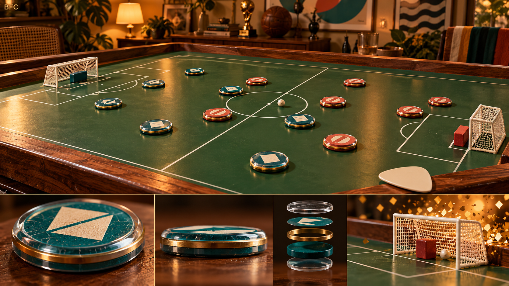
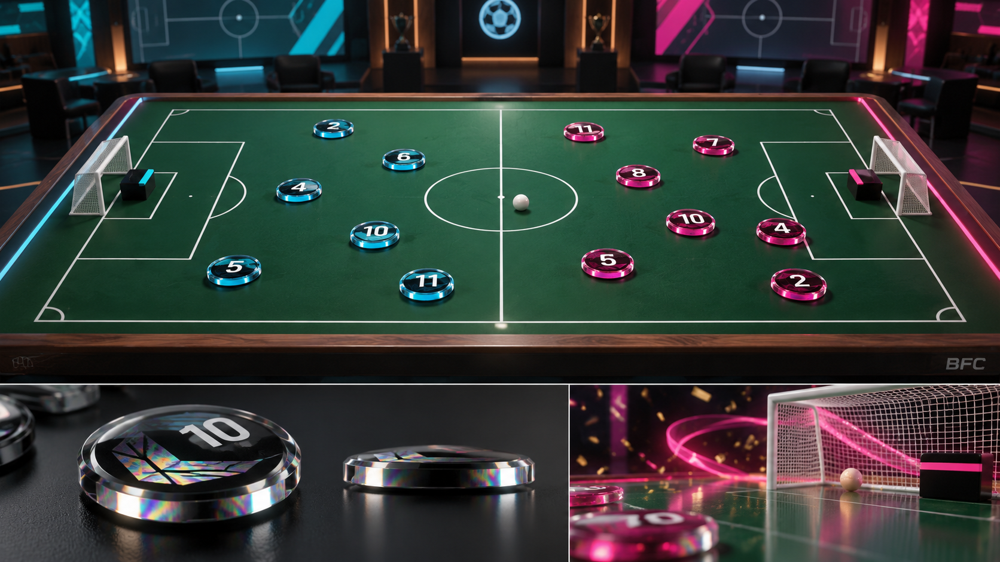
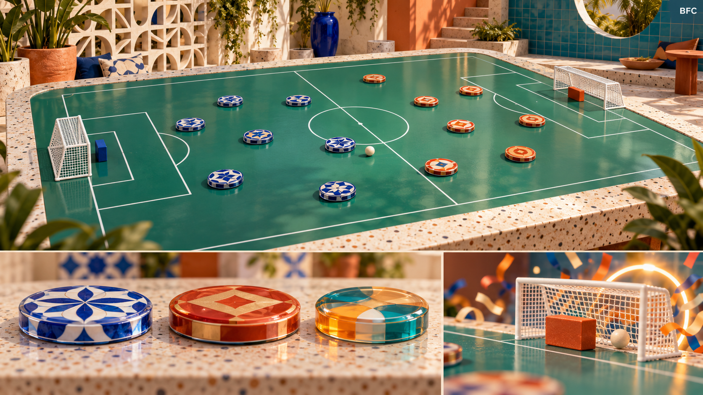

# BFC — auditoria técnica e direção de produto

Data: 18/10/2026. Análise solicitada pelo proprietário para confrontar conversa, código e documentos. Este relatório registra evidências e propostas; não homologa os experimentos nem transforma recomendações em regras.

## Parecer

O projeto merece continuidade. Há uma base C# organizada e um laboratório de jogabilidade com funcionalidades reais. A física atual é um protótipo controlado, ainda sem validação suficiente para ser anunciada como simulação realista. A prioridade é consolidar uma partida curta, calibrada com uma mesa física, com som e feedback convincentes. Recomendo continuar em Unity 6.3 LTS + URP, acrescentar Blender ao pipeline de arte e adiar Houdini e eventual migração para Unreal até existir um impedimento medido.

## 1. O que foi recuperado e conferido

- Conversa compartilhada: https://chatgpt.com/share/6ad51c50-dff0-83e9-8a1e-b7cb374322f5. Lida no navegador, inclusive os pedidos intermediários sobre imersão, goleiro e espaço tático.
- Repositório completo clonado em `C:\BFC`, com histórico e branches remotas.
- `origin/main`: `4476640cb7a08239bbd0b87ff07a1a8e7e135988`.
- Ponta experimental auditada: `1b734bb3f433fb598c2db55d655a2b04f581a584`, de `origin/experiments/disc-collider-fidelity`.
- Branch local de auditoria: `audit/project-assessment-2026-10-18`.
- A cadeia dos PRs #13–#19 e #21–#25 existe, está aberta e em draft; PR #12 contém a especificação de ações avançadas e não faz parte dessa cadeia. Nenhum merge foi realizado nesta auditoria.
- A issue #20 e o guia `CODEX_VALIDATION_MASTER.md` pedem testes reais de Unity. Checks verdes existentes executam Python, não Unity.
- `BFC(1).zip` e `Interface e Menu.zip` não estão no repositório; também não foram encontrados na busca direcionada em `F:\Projetos` e Downloads. Não foi comprovada fidelidade ao legado ou à interface. `BFC-main.zip` em Downloads não substitui essas referências.

A conversa descreve avanços reais, mas sua primeira análise se refere à main anterior. A versão experimental já conecta input, autorização, lançamento, detecção de gol e reinício. Afirmar hoje que essa integração inexiste em todo o projeto seria incorreto. A própria conversa distingue implementado de validado, e essa distinção deve continuar.

O handoff `BFC_PROJECT_CONTINUITY.md` diz que o PR #11 continua aberto e que o HEAD canônico é o merge anterior. A consulta ao Git comprova que #11 foi integrado e main avançou. O README também descreve uma etapa anterior ao código atual. Documentos são evidência de intenção e histórico; comportamento, compilação e qualidade exigem comprovação independente.

## 2. Futebol de botão e identidade do BFC

A CBFM publica modalidades distintas: 1 Toque, 3 Toques, 12 Toques, Dadinho, Sectorball, Chapas e Subbuteo. Uma modalidade não deve fornecer regras universais para as outras. [Fonte oficial](https://www.cbfm.com.br/regras/).

Na regra Bola 12 Toques de 2025, a palheta aciona discos sobre a mesa; há 10 botões e um goleiro retangular. O limite coletivo e o individual são distintos. Posicionamento do goleiro tem situações próprias. A determinação de saída considera o apoio da bola, portanto não se deve importar automaticamente a regra de bola inteira do futebol de campo. [Regulamento oficial, arts. 14–15, 25–27, 35 e 50](https://www.cbfm.com.br/download/1842/).

Para o BFC, recomendo dois perfis de experiência com identificação clara: o controle moderno acessível e um Classic com modalidades escolhidas e conferidas artigo por artigo. Três ações genéricas do laboratório não comprovam aderência à modalidade 3 Toques. Goleiro automático pode ser uma escolha própria do BFC moderno; não é uma verdade do esporte. O desejo mais recente do usuário privilegia reposicionamento em momentos específicos, preservando as diferenças entre modos.

O protagonista visual é um objeto pequeno e tátil: disco, acrílico, impressão, palheta, mesa, bloco do goleiro. A imersão pode trazer a câmera ao nível das peças durante a resolução e os replays, mantendo visão estável e clara para planejar. Sem substituir os botões por atletas ou a mesa por um gramado gigante.

## 3. Implementações que valem preservar

| Evidência no código | Valor para o projeto | Limite atual |
|---|---|---|
| `Core` e `Gameplay` com assemblies independentes | Regras e transições testáveis, menor dependência da cena | Contratos físicos avançados ainda ficam no laboratório |
| `MatchController` bloqueia ações enquanto resolve | Evita lançamentos concorrentes | Não arbitra sozinho contatos e reposições |
| `FormationSpawnPlanner`, composições e perfis | Campo e quantidade configuráveis | Formações de preview não foram validadas com jogadores |
| `FormationLabPlaytestController.TryLaunch` | Humano e IA passam pelo fluxo de autorização | Um MonoBehaviour de 687 linhas concentra muitas funções |
| Perfis 28×18, 36×23, 42×27, 48×31 | Comparação controlada de espaço | Unidades e escalas não representam uma mesa real calibrada |
| Passe, corredores, câmera e telemetria | Ferramentas úteis para estudar a jogabilidade | Corredor livre não comprova passe executável |
| Janela de goleiro com equipe, área, tempo e confirmação | Base útil para permissão explícita | Não implementa uma modalidade completa |
| Correção do diâmetro visual dos discos | Elimina discrepância real entre render e raio da hitbox | Collider padrão ainda é esfera |

Não encontrei arte final, áudio, modelos Blender/FBX ou loja funcional em `Assets`. Assemblies vazios de Progression/AI não comprovam esses sistemas. O executável de produção padrão abre Bootstrap; o laboratório precisa de entrada/build próprio e flag `-bfcPlayableLab`.

## 4. Problemas concretos e lacunas

### A1 — três bloqueadores de compilação na branch experimental

`Assets/BFC/FormationLab/FormationLabRuntimeBootstrap.cs:1,31`: o experimento adicionou `using System;` e manteve `Object.FindFirstObjectByType`. A Unity confirmou CS0104, por colisão entre `System.Object` e `UnityEngine.Object`. Após corrigir essa referência, a compilação também confirmou CS0246 em `FormationLabPlaytestController.cs`: faltava importar `BFC.FormationLab` para resolver `FormationPieceRuntime` e os demais tipos do laboratório. Em seguida, revelou CS0103 em `FormationLabGoalLine.cs`, também sem esse namespace para acessar `FormationLabRuntimeBuilder`. Os três foram corrigidos localmente, qualificando `UnityEngine.Object` e adicionando os dois `using` ausentes. Os validadores Python haviam passado sem encontrar esses problemas, pois não compilam C#.

### A2 — spin pode cancelar o chip

`LabSpinMotion.Step`, em `LabBallSpinController.cs`, devolve `new Vector3(..., 0f, ...)` em todos os caminhos. O FixedUpdate escreve esse vetor de volta na velocidade da bola. `FormationLabPlaytestController.TryLaunch` arma spin e chip simultaneamente se o jogador selecionar Q/E e H. Após o contato, a componente vertical do chip é apagada pelo spin. A suíte existente testa spin e chip separados e não cobre a combinação. Preservar a componente vertical e testar a interação é prioritário.

O integrador lateral usa Euler explícito: `v' = v + k dt Jv`. Isoladamente, aumenta o módulo por um fator `sqrt(1+(k dt)^2)` antes do limite. Isso é um desvio matemático, não uma medição de energia da partida inteira. A solução deve integrar a rotação de direção sem ganho artificial e considerar perdas físicas separadas.

### A3 — chip é um impulso adicional, ainda sem aterrissagem física

`LabBallChipFlight.OnPieceContact` chama `StartVerticalFlight(2+4*potência)` após o contato identificado. Não calcula sustentação a partir da geometria do contato. `PlanarKineticBody.TryLand` recoloca o centro na altura de repouso e elimina a velocidade Y; a mesa não tem colisão ativa e a desaceleração de chão continua durante o voo. É um experimento válido para sensação e controles, insuficiente para simular quique, deslizamento/rolagem, energia e contato realista. Um modo moderno pode adotar uma abstração declarada; Classic exige outra validação física.

### A4 — trave e goleiro ainda não representam o equipamento

`FormationLabRuntimeBuilder.CreateGoal` desenha postes e travessão por `CreateMarking`, que desabilita os colliders. O volume de gol é trigger. Logo, não existe rebote físico da trave nessa montagem. A verificação numérica de altura em `FormationLabGoalLine` evita certos gols altos, mas não cria uma colisão com o travessão.

`CreatePiece` usa a mesma geometria de disco para linha e goleiro, alterando cor e papel lógico. Para a proposta Classic, construir um bloco com BoxCollider e medidas coerentes. Separar objetos físicos de marcações decorativas; não habilitar indiscriminadamente colisão em todas as linhas do campo.

### A5 — resta completar uma partida e arbitrar suas saídas

O laboratório trava após bola fora e exige R, apagando o estado da partida. A posse continua após colisões e só alterna pelo contador configurado. Não há chamadas runtime a `AdvanceClock` ou `FinishMatch`, apenas nos testes. O construtor recebe 15 minutos, mas o relógio da demonstração não avança. Não há ciclo completo de partida com duração, resultado final e todas as reposições.

Isso é compreensível num laboratório isolado, mas bloqueia uma demonstração comercial contínua. Criar primeiro reposições explicitamente experimentais por perfil; definir regras definitivas por decisão de produto e teste, sem importar regras de futebol de campo.

### A6 — realismo e determinismo não estão comprovados

`PlanarKineticBody` aplica desaceleração constante, limita velocidades e usa PhysX para contatos. Peças não recebem impulso em ponto de impacto nem torque correspondente à palheta. `IsAtRest` considera velocidade planar e voo, mas não repouso angular. Os parâmetros de massa, escala e restituição não têm medições reais anexadas.

O benchmark existente exclui colisões e compara três discretizações da equação de frenagem. FixedUpdate é uma boa base, mas não prova simulação idêntica entre plataformas. A própria opção Enhanced Determinism da Unity tem condições e custo; não é uma garantia geral de replay ou rede. [Unity Physics settings](https://docs.unity3d.com/6000.3/Documentation/Manual/class-PhysicsManager.html).

É preciso testar penetração e contatos rápidos. CCD tem custos e limitações de geometria, portanto o perfil ConvexDisc deve ser medido junto com timestep e solver. [Unity CCD](https://docs.unity3d.com/6000.3/Documentation/Manual/ContinuousCollisionDetection.html).

### A7 — IA e telemetria são úteis, ainda experimentais

`LabTacticalOpponentPlanner` busca uma peça, avalia distância, bloqueios e lado da bola, e lança em sua direção. Não simula antecipadamente contato, recuperação, passe ao receptor ou defesa. Pode escolher um objetivo fora do alcance do golpe. É uma primeira heurística honesta, não uma IA tática completa.

O CSV mede trajetória projetada no plano XZ, não comprimento 3D do chip. O relatório agrupa campo e ação, mas não controlador, versão da física, perfil de collider ou spin. Adicionar essas dimensões e IDs de sessão/seed antes de comparar experimentos misturados. Guardar altura máxima e tempo de voo para calibrar chip.

## 5. Física como diferencial verificável

Recomendo começar com PhysX 3D, botões restritos ao plano e bola 3D, usando geometrias de colisão simples e calibradas. Separar deslizamento, rolamento e voo. A força deve agir na peça; a bola deve responder ao contato. No Classic, usar ponto de aplicação e torque, com forma e borda do disco representadas suficientemente para o comportamento desejado. Evitar perseguir uma simulação da deformação completa da palheta antes de validar um modelo reduzido por medições.

Obter uma mesa, botões e bola representativos. Medir escala com régua; gravar câmera superior e lateral com referência temporal; coletar paradas após impulsos, impactos frontais/rasantes, restituição na trave e quique. Repetir em diferentes potências e estimar dispersão. Ajustar coeficientes contra dados que não participaram do ajuste. Realismo deve ser medido dentro da variabilidade do equipamento, e não apenas avaliado pela aparência.

Guardar para cada lance estado inicial, comando, versão do perfil físico, timestep e estados amostrados. Testar repetição na mesma versão e hardware antes de prometer determinismo entre máquinas. Para online futuro, considerar servidor autoritativo e correção de estado; replay pode gravar estados em vez de depender só de ressimulação por input. Não escolher lockstep antes dessa evidência.

## 6. Campo maior, estratégia e diversão

O objetivo recuperado da conversa é ter espaço para planejar, construir a jogada e sentir que a execução deu certo. Recomendo comparar 36×23 e 42×27 primeiro, com 28×18 como controle e 48×31 como extremo. Não declarar 42×27 vencedor por preferência documental.

Com o modelo atual, uma peça lançada a 8,5 e desacelerando a 4,8 tem alcance contínuo isolado de aproximadamente 7,53 unidades; um passe com limite de velocidade de 55% tem alcance próximo de 30,25% do chute, cerca de 2,28 unidades. São estimativas sem colisões, não medições da bola. Reduzir velocidade reduz alcance de forma quadrática nesse modelo. Num campo muito maior, esse passe pode nem chegar à bola quando as peças estão afastadas.

Avaliar alcance em diâmetros de botão e fração de campo, espaços entre peças, tempo para construir ataque, ações sem contato, variedade de soluções, desperdício de movimentos e vontade de repetir a partida. Registrar notas dos jogadores, não só CSV. Iniciar sessões com desafios de três decisões: abrir linha, preparar contato, finalizar. Evitar mira que garanta um passe, correção escondida de bola e modificadores pagos de desempenho.

Começar com sessões curtas e reinício rápido; testar duração depois. Tutorial visual e prática assistida devem ensinar arrasto, força e contato também para quem nunca viu futebol de botão. Apresentar em inglês como “Brazilian button football” com demonstração visual evita depender de conhecimento prévio do esporte.

## 7. Engine e ferramentas

| Opção | Avaliação para este projeto |
|---|---|
| Unity 6.3 LTS + URP | Recomendação atual: aproveita código C#, teste e pipeline existentes. Uma mesa com poucas dezenas de corpos não justifica migração por escala. URP pode sustentar a direção proposta com boa iluminação, materiais e VFX calibrados. |
| Unreal + Niagara | Alternativa válida se a equipe dominar esse pipeline ou um comparativo real demonstrar ganho de produção e qualidade. Niagara é uma ferramenta forte de efeitos, mas não resolve calibragem de contatos ou diversão por si. Reescrever runtime C# tem custo real. |
| Godot | Possível para jogo de mesa 3D, sem evidência de benefício que compense trocar agora. Não foi prototipada nesta auditoria. |
| Blender | Alto valor imediato: modelar botões com chanfros, goleiro, palheta, mesa e gol; UV, bake de normais, texturas, LOD e imagens promocionais. Separar mesh visual de mesh de colisão. |
| Houdini | Adiar até variações procedurais em quantidade justificarem o custo e aprendizado. Modelagem modular em Blender atende à primeira arena. |

A documentação oficial distingue URP e HDRP por objetivos e recursos; não há necessidade demonstrada de HDRP aqui. [Unity pipelines](https://docs.unity3d.com/6000.3/Documentation/Manual/choose-a-render-pipeline.html). Unity recomenda formatos exportados em vez de depender da aplicação de modelagem instalada: manter `.blend` como fonte e exportar FBX para importação consistente. [Unity model formats](https://docs.unity3d.com/6000.3/Documentation/Manual/3D-formats.html). [Blender glTF](https://docs.blender.org/manual/en/5.0/addons/import_export/scene_gltf2.html) é outra opção mediante importador/pipeline compatível, não uma dependência já presente no BFC. [Niagara oficial](https://dev.epicgames.com/documentation/en-us/unreal-engine/creating-visual-effects-in-niagara-for-unreal-engine).

Se houver comparação de engines, usar o mesmo asset, iluminação-alvo, resolução, hardware, input e cena de contatos; medir tempo de produção, frame time P95/P99 e consistência física. Não usar demonstração vazia ou render offline como comparação com gameplay. Meta inicial proposta: 60 FPS estáveis no hardware mínimo a definir; não é uma validação já realizada.

Custos precisam de revisão ao lançar: o Runtime Fee da Unity foi cancelado, e a elegibilidade dos planos depende das condições vigentes. Unreal tem condições de royalties próprias. Não estimar lucro com base em slogans de licença. [Unity pricing](https://unity.com/products/pricing-updates), [Unreal licensing](https://www.unrealengine.com/license).

## 8. Três direções visuais produzidas

**1 — Herança premium:** madeira, verde profundo, luz quente, acrílico e impressão visível. Melhor ponte emocional com a memória brasileira. Ideal para mesa inicial e coleção retrô. Usar textura sutil: brilho excessivo e desgaste exagerado podem esconder bola e linhas.

**2 — Arena contemporânea:** minha recomendação como apresentação principal. Preserva a mesa física e adiciona acentos cyan/magenta, ambiente de transmissão e colecionáveis modernos. Campo recebe luz neutra; espetáculo fica na borda e nos momentos de gol. A sensação tátil da proposta 1 deve entrar nessa direção.

**3 — Mesas do mundo:** coleção de ambientes e estampas com identidade local e acabamento de objeto de design. Caminho para conteúdo internacional e colaborações com artistas. A primeira exploração usa referências brasileiras de azulejo e arquitetura; futuras culturas pedem pesquisa e colaboração específicas.

As imagens foram geradas com a ferramenta integrada ImageGen e inspecionadas visualmente; os prompts completos estão em `art/PROMPTS.md`. São conceitos aspiracionais. Não demonstram performance, geometria exata, regras, número de peças, implementação de materiais ou viabilidade de todos os reflexos em tempo real.

### Gramática audiovisual recomendada

- Mira: câmera firme, contorno e potência claros; sem distorção ou balanço.
- Impacto: som de acrílico, clique da palheta, vibração e reação visual discretos, ligados à velocidade/impulso real.
- Movimento: sombra de contato legível e rotação coerente; rastro curto opcional sem esconder a bola.
- Gol: reação da rede, áudio e luz localizada, câmera curta de celebração e replay pulável. Partículas fora da área crítica.
- Acessibilidade: redução de movimento, intensidade de VFX, identificação por número/padrão além de cor e feedback sem depender apenas de áudio.

Acrescentar som já no próximo slice. A matéria sonora do toque e do rebote vende a sensação física tanto quanto o material do botão.

## 9. Cosméticos e sustentabilidade comercial

Proposta comercial, não previsão de receita: vender estampas, acabamentos de acrílico, palhetas visuais, blocos do goleiro, molduras de mesa, cenários externos, emblemas, vitrine, animações curtas e comemorações. Fazer cada item aparecer bem na seleção, no close/replay e na coleção. Modelos de impressão sob acrílico são escaláveis e preservam forma legível.

Cosméticos devem consumir um perfil físico competitivo imutável: mesma hitbox, massa, atrito, potência, assistência e tempos. Cores/som de bolas e superfícies precisam de limites de leitura. Uma mesa premium muda aparência, sem introduzir atrito diferente em partida ranqueada. O oponente deve poder reduzir efeitos sem perder informação.

Começar com venda direta de poucos conjuntos originais, preview honesto e coleção utilizável. Não depender de escudos licenciados, caixas aleatórias, conteúdo diário massivo ou grande infraestrutura antes de comprovar procura. Skins são uma hipótese de negócio; retenção, preferência estética e disposição a pagar precisam de testes. Rentabilidade depende também de custo de aquisição, comissões, suporte, servidores e produção contínua. Evitar precificar antes de conhecer público e plataformas.

## 10. Sequência recomendada para continuar

1. **Consolidar a branch experimental:** corrigir bloqueadores de compilação; rodar Unity, registrar XML e falhas por cenário. Revisar dependências da cadeia de PRs, sem integração automática.
2. **Contrato físico e Classic:** palheta → impulso/torque na peça → contato → bola; ajustar geometrias, trave, chão, voo, spin e repouso com dados reais.
3. **Partida curta completa:** posse por perfil, reposição coerente, relógio/fim, placar, reinício e goleiro definido. Entrada clara para executar a demonstração.
4. **Slice audiovisual:** uma mesa, uma coleção de botões, som, HUD limpo, câmera tática e replay. Fazer arte e interação evoluírem juntas.
5. **Playtest Brasil + público internacional:** aprender controles, entender erros, completar partidas e pedir revanche. Comparar escalas sem mudar a física simultaneamente.
6. **Coleção comercial pequena:** testar atratividade de cosméticos e pipeline de conteúdo. Online e loja autoritativa quando a experiência e a demanda justificarem.

Condições de aprovação: testes técnicos passam, contatos são explicáveis, jogadores completam partidas sem assistência do desenvolvedor, e a apresentação preserva leitura competitiva. Nenhum documento ou imagem substitui esses resultados.

## 11. Evidências de execução

Resultados e limitações atualizados no arquivo `VALIDACAO.md`. As evidências de execução têm prioridade sobre as contagens históricas mencionadas na conversa. Esta auditoria não comprova diversão, adesão a todas as modalidades nem rentabilidade comercial.

**Fechamento da execução:** na Unity 6000.3.21f1, EditMode **25/25** e PlayMode **34/34** passaram após três correções de namespace e ajuste temporal de dois testes de goleiro. Os testes Python passaram **4/4**. A prova isolada do goleiro confirmou que a posição física já estava correta; a leitura do Transform precisava aguardar o passo de física seguinte. Não houve alteração de gameplay ou tuning para obter esses resultados. A combinação spin/chip e demais lacunas A2–A7 permanecem no backlog, sem homologação de realismo.
